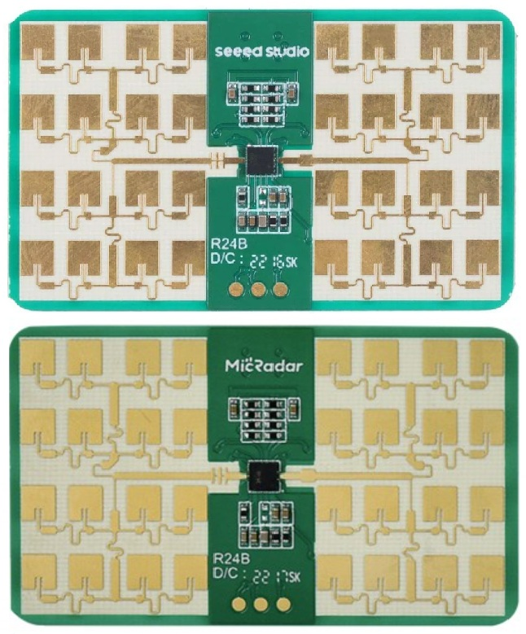

# Arduino Library for MR24BSD1 and R24BBD1 24GHz mmWave Sleep Monitoring Sensors

_Copyright (C) 2026, muman.ch + github.com/mumanchu_ \
_Released under the terms of the BSD 3-Clause License_

There are two versions of this 24GHz mmWave board. The "MR24BSD1" is the Seeed Studio version, and the "R24BBD1" is the original MicRadar version. The Seeed Studio manual has the MicRadar model number 'R24BBD1' on its cover, so I guess they are the same board. They may contain different firmware, but I'm still waiting for my MicRadar board to arrive.



These mmWave boards are not only for presence detection. They have large radar arrays which are sensitive enough to measure breathing and even heartbeats. If mounted above or below a bed, it will tell you if the bed is occupied, if the occupant is breathing and (hopefully) if (s)he still has a heartbeat. I assume it will also work if you are reclining on the sofa (extensive testing is in progress :-)

There is not much code available for these boards, so here is an Arduino-style C++ class (written by one of the few remaining human programmers, soon to be plagiarised by AI). It should be easy to adapt it for any architecture.

> [!NOTE]
> These old boards are becoming obsolete, there are very few for sale. Maybe because there was no decent software for them. Until now ;-) \
> I guess they are being replaced by the (more expensive) 60GHz versions.


<!--
## Firmware Versions and Updating the Firmware

TODO

fw update it works for the MR24HPC1 - what about the MR24DSD1? \
https://wiki.seeedstudio.com/Radar_MR24HPC1/#firmware-version-updates
-->


## Safe For 3.3V MCUs

Although the sensor's supply is 5V, its outputs are all 3.3V. This is because the onboard MCU runs at 3.3V, from its own on-board 3.3V LDO regulator. **So these sensors are safe to use with 3.3V MCUs :-)**

To avoid complications, it is recommended that these sensors are not used with old 5V MCUs. 

The sensor's RX input is probably 5V-tolerant - but there is no mention of this in the documentation. To be safe, if you must use a 5V MCU, put a 10K resistor between the 5V MCU's TX output and the sensor's RX input. This will also protect against back-powering the sensor through the sensor's RX input's protection diode, if the sensor's 5V supply is disconnected while the MCU still has power. That could damage your board if more than (about) 1mA flows into the RX input.

> [!TIP]
> A 10K resistor is particularly important if you are using a P-CH MOSFET to switch the sensor's power off/on to reset the sensor, because the `reboot()` command does not work. (That would be required in a production version.) Or you could set the TX output to high impedance by configuring it as an INPUT while the sensor is powered off. \
> In fact, if you have long RX/TX wires that run outside the sensor's enclosure, it's good practice to put 10K resistors in both the TX and the RX lines at the MCU end. This reduces echoes on the wires and gives additional protection against ESD. 


## 5V Power Supply 

The Seeed Studio manual recommends a separate 5V 200mA power supply for the sensor. I measured the actual current to be about 93mA (round up to 100mA), which matches the value in the Electrical Characteristics of the MicRadar data sheet.

If the MCU and the sensors are powered by 5V from the USB, then all is good. If the sensors are being powered through the MCU's on-board 5V regulator (400..900mA), then make sure there's at least 100mA available for each sensor. If not, you will need a separate 5V power supply for the sensors.


## Serial Communications

The sensors use serial communications at a fixed speed of 9600 bps. This is nice because it works well with either `SoftwareSerial` or `HardwareSerial`. With SoftwareSerial, you do not lose a serial port and (almost) any GPIOs can be used. SoftwareSerial must be interrupt-driven. 

Once initialised, the sensor sends unsolicited _report_ messages one or more times a second to report the presence, motion, breathing and hearbeat states. These report messages must be regularly polled, as described below.

Command messages can also be sent to the sensor, which returns a response if the command was successfully processed. If a command is sent at the wrong moment (e.g. while the sensor is sending a report message), it will often be ignored and there will be no response. The library detects this and re-sends the command (retries).

All messages are binary (not ASCII characters), with a Modbus CRC-16 checksum for each message. 

```
Message frame is:
byte | 0     | 1   2   |  3       | 4         | 5         | 6..len-7  | len-1   |
     | start | length  | funcCode | addsCode1 | addsCode2 | data...   | crc16   |
     | 55    | lsb msb | xx       | xx        | xx        | xx...     | lsb msb |
```

## S1 and S2 Outputs

If the sensor is being used only to detect presence and motion, then these two outputs are all you need. You don't even need this library (except for configuration).

3.3V = high, 0V = low \
S1 Output : high = occupied, low = unoccupied \
S2 Output : high = motion detected, low = stationary or unoccupied

The four general-purpose GPIOs, GP1..GP4, do not seem to be usable, although they are wired to the connector. It would have been nice if there were serial commands to access these. I guess they need custom firware to be usable.


## Startup Time, "abnormal reset" and "init successful" report messages

After powering up, the data sheet says the sensor needs about 30 seconds of settling time before the data it sends is valid, ref. Data Sheet section 7.1. 

The 30-second settling time starts immediatly after the reset. In some cases the sensor will not respond at all for almost 30 seconds.

After a power up or if an internal error is detected, the sensor first sends an "abnormal reset" report message, then goes into its initialization procedure. Once complete, it sends an "initialization successful" message. 

This 30 second delay is not handled by this library. Instead, an `isReady()` method has been implemented to handle the "abnormal reset" and "init successfuk" messages.

Call `isReady()` at least every 200ms to wait for the "initialisation successful" message, as shown in the example sketch. During this period the sensor may not respond to commands and the report messages may contain invalid readings and even invalid CRCs. Sometimes it sends undocumented report messages during this period.


## Polling the Sensor

Polling can start after `isReady()` returns `true`. After that, the sensor transmits _report_ messages several times a second.

The sensor should be polled at least every 200 milliseconds to avoid losing messages. Do this by calling `pollMessage()` from within `loop()`, as shown in the example sketch. You can use a 200ms timer, or just poll it continuously as fast as possible. It takes only a few microseconds to determine if a message is being received, and about 4 milliseconds to process a new message.

Each character is validated by the `receiveByte()` state machine as it is received. Each complete message is validated with its Modbus CRC-16 checksum, and the message content is also checked. Only valid messages are processed. Detailed checking of the message contents ensures that the protocol has been correctly understood and is being correctly processed by the library. Sometimes the manual is difficult to understand.

If a report message is lost, it usually does not matter because the state machine will re-synchronize and the next report message will be received correctly. If a command response is lost, the command is re-sent with up to two retries (three attempts).

> [!TIP]
> If your software hits a breakpoint, or delays too long between polls, bytes will be lost and communications errors will be reported. However, the state machine will always re-sync and recover. \
> Do not use a timer interrupt for polling, because communications methods will not work if called from an interrupt handler (in the Arduino environment).


### Startup and polling example

```cpp
void loop()
{
    ulong t = millis();

    // poll the sensor from loop() at least every 200ms
    // if slower, then data may be lost and communications errors may occur
    static ulong t1 = 0;
    if (t - t1 >= 200) {
        t1 = t;

        // if the sensor has finished initalizing, 
        // then we can configure it and start polling
        if (sensor.isReady()) {

            // when a report message is received from the sensor, 
            // pollMessage() processes it and updates the values in the 
            // sensor.properties structure
            // occupiedStateChanged() is called if the occupied state changes
            sensor.pollMessage();

            // when first ready, do one-time reads and configuration
            // (note that the settings are stored in nonvolatile memory, 
            // so you only need to program them once)
            static bool sensorConfigured = false;
            if (!sensorConfigured) {
                sensorConfigured = true;

                // these can be used to determine communications behaviour
                sensor.readFirmwareVersion();
                sensor.readProtocolVersion();
                // we want to do sleep monitoring too
                //sensor.enableSleepMonitoring(true);	// do this once
                sensor.readSleepMonitoring();
            }
        }
    }
}
```


## Configuration

The settings are stored in nonvolatile memory, so they only need to be programmed once. 

Because the sensor has a start-up period, you may not be able to configure it in `setup()`. Wait until `isReady()` returns `true` before calling any of the `writeXXX()` commands. One way to do this is shown in the example sketch.

After configuration, the sensor probably needs a power-up reset or a reboot, but this is not specified in the documentation. 

There are only four settings which can be configured.

### Unoccupied delay

`bool writeUnoccupiedDelay(byte unoccupiedDelay);` \
This is the delay between the last detection of motion and the change of state to 'Unoccupied'. This could be used to keep lights on for a minimum period. \
0=none (default), 1=10s, 2=30s, 3=1min, 4=2min, 5=5min, 6=10min, 7=30min, 8=60min

### Scene

`bool writeSceneSetting(SceneSettng scenesetting);` \
The Scene setting selects a pre-programmed set of parameters to configure it for a specific environment. The documentation does not provide many details about these settings. \
0=default, 1=area, 2=bathroom, 3=bedroom, 4=living room, 5=office, 6=hotel

### Sensitivity

`bool writeSensitivitySetting(byte sensistivity);` \
0..10 : 0=not initialised, 1=minimum sensitivity, ..., 10=maximum sensitivity, default=7

### Enable/disable sleep monitoring

`bool enableSleepMonitoring(bool enable);` \
Enables or disables sleep state monitoring. If not enabled, none of the sleep state reports will be sent. Keep this disabled if you are only doing presence and motion detection.

Use the `readXXX()` methods to read the current settings.


## Reboot Command

A reboot or power up may be needed after any of the settings are changed, but this is not specified in the documentation. 

Unfortunately, the reboot command described in the manual does not work with my sensor. This could be because it has an old version of the firmware. 

My firmware version is G24VD1SYV010105 (v1.1.5). According to an AI query, there was a version v1.1.6, but I can't find any information about it.

I asked about this on the product's Seeed Studio Wiki, but have received no replies so far.

> [!NOTE]
> There will be an update if I find out more.


## Heartbeat

The Seeed Studio version reports a `heartbeatState` and a `heartbeatRate`, but the MicRadar version does not mention this in its documentation. 

Some mmWave sensors, which only send messages when something changes, implement a 'hearbeat' message which just informs the MCU that the sensor is still alive. This has nothing to do with a person's actual heartbeat.

The MR24BSD1 seems to implement the person's actual heartbeat.

But is it accurate?

...
<!-- TODO test it! -->


## Library Features

* This library supports all the features and messages described in the manual (depending on the firmware version).

* It has callbacks for when the _occupied state_ or _sleep state_ changes. The _bed occupied state_ could be handled in the same way.

* Because these sensors may be used in critical environments (hospitals, nursing homes, morgues, etc), additional "sensor not responding" and "sensor not initialized" features have been implemented.

* Uses a simple state machine (6 states) for receiving and validating message frames from the sensor.

* Optionally displays all messages sent and received, in hex. This is very useful for testing and understanding the binary protocol. Comment out `#define DEBUG` to define the `MR24BSD1_PRINT()` macros as empty (do nothing).

* Has an `isReady()` method to determine of the sensor is initialized, is producing valid data, and is ready to receive commands. It is not ready until the "initialization successful" message has been received after the reset.

* Maintains all the sensor's data in a memory-optimised `MR24BSD1Properties` structure.

* Supports multiple sensors on different `SoftwareSerial` ports (depending on your MCU).

* The source code contains meaningful comments, making it easy to understand what each method does, and why.


## Installing the Library

Download the latest ZIP file with green button on this library's Github screen, "<> Code / Download Zip". This downloads a file called "MR24BSD1mmWave-main.zip" into your Downloads directory.

You can just unzip this file and access the source coude in `src` and the example sketch in `examples\MR24BSD1mmWave-Example\MR24BSD1mmWave-Example.ino`. Copy the files in `src` into the example sketch directory and open the sketch.

**Installing the ZIP file with the Arduino IDE**

Select menu item "Sketch / Include Library > Add ZIP Library...". This opens the "Select ZIP File" window. Open the Downloads directory and choose the "MR24BSD1mmWave-main.zip" file you just downloaded. You should see a "Successfully installed library" message.

To open the example sketch, select menu item "File > Examples" and scroll down beyond "Examples from Custom Libraries" and choose the "MR24BSD1mmWave > MR24BSD1mmWave-Example" entry. This opens the "MR24BSD1mmWave-Example.ino" example sketch in a new Arduino IDE window.


## Class Reference

Full descriptions of each method can be found in the source code [MR24BSD1mmWave.h](src/MR24BSD1mmWave.h). The descriptions are not duplicated here.

The library is in a single include file, not in two separate `.h` and `.cpp` files. This is fine if you want to access the class from a single source file, which is the usual case. If you need to access it from more than one source file, then move the code into its own `.cpp` file.

```cpp
class MR24BSD1mmWave
{
public:
    enum OccupiedState : byte {
        Unoccupied = 0,
        Stationary = 1,
        Moving = 2
    };
    enum MotionState : byte {
        NotInit = 0,
        NoMotion = 1,
        Approaching = 2,
        MovingAway = 3,
        MovingAbout = 4,
        Undoc1 = 5              // ? undocumented
    };
    enum BreathingState : byte {
        Normal = 0,             // still alive
        NotBreathing = 1,       // "abnormal suffocation" !
        NoSignal = 2,           // breathing state not available/unoccupied
        Undoc2 = 3,             // ? undocumented
        Abnormal = 4,           // too much movement to detect breathing
        Rapid = 5               // excercising?
    };
    enum SleepingState : byte {
        Awake = 0,
        LightSleep = 1,
        DeepSleep = 2,
        SleepStateNotAvailable = 3
    };
    enum BedOccupiedState : byte {
        OutOfBed = 0,
        InBed = 1,
        BedStateNotAvailable = 2
    };
    enum SceneSetting : byte {
        Default = 0,
        Area = 1,
        Bathroom = 2,
        Bedroom = 3,
        LivingRomm = 4,
        Office = 5,
        Hotel = 6
    };

    // Use 1-byte structure member packing to minimize memory use
    #pragma pack(push)
    #pragma pack(1)

    // All sensor data is maintained in this structure
    struct MR24BSD1Properties
    {
        bool abnormalReset;             // sensor is initialising
        bool initSuccessful;            // sensor is initialized, after "abnormal reset"
        bool responding;                // sensor is sending messages (5 second timeout)

        // Sensor Readings from report messages
        OccupiedState occupiedState;    // (can also be read with readOccupiedState())
        MotionState motionState;
        BreathingState breathingState;
        byte motionAmplitude;           // 0..100% (can also read with readMotionAmplitude())
        byte breathingRate;             // breaths per minute
        OccupiedState heartbeatState;   // occupied state of creature with heartbeat?
        byte heartbeatRate;             // beats per minute

        //>>> Sleep State Monitoring, requires enableSleepMonitoring(true)
        bool sleepMonitoringEnabled;
        BedOccupiedState bedOccupiedState;
        SleepingState sleepingState;
        // up to 4'294'967'295 minutes of sleep, that should be enough
        ulong minutesAwake;
        ulong minutesOfLightSleep;
        ulong minutesOfDeepSleep;
        // the manual says sleep quality is "combined day's sleep rating", or
        // "sleep scoring (optional, users can rate according to their own way)"
        byte sleepQuality;
        //<<<

        // Sensor information
        // if needed, these must be initialized by the relevant readXXX() commands
        char deviceId[14];              // "96uIag1tfhihh" (examples from my board)
        char firmwareVersion[16];       // "G24VD1SYV010105"
        char hardwareVersion[5];        // "R24A"
        byte protocolVersion;           // 1

        // Settings
        // if needed, these must be initialized by the relevant readXXX() commands
        // 0=none (default), 1=10s, 2=30s, 3=1min, 4=2min, 5=5min, 6=10min, 7=30min, 8=60min
        byte unoccupiedDelay;
        // 0=default, 1=area, 2=bathroom, 3=bedroom, 4=living room, 5=office, 6=hotel
        SceneSetting sceneSetting;
        // 0=not init, 1=minimum sensitivity, 10=maximum sensitivity, default=7
        byte sensitivitySetting;
    };

    #pragma pack(pop)	// back to default structure member packing

    // This structure holds all the sensor's data
    MR24BSD1Properties properties;

    // Callback if occupied state changes, NULL if not used
    void (*occupiedStateChangedCallback)(MR24BSD1mmWave* thisSensor,
        OccupiedState newState, OccupiedState oldState) = NULL;

    // Callback if sleeping state changes, NULL if not used
    void (*sleepingStateChangedCallback)(MR24BSD1mmWave* thisSensor,
        SleepingState newState, SleepingState oldState) = NULL;

    // TODO more notification callbacks could be added here
    // (e.g. callback if heartbeat stops)

    // Methods
    MR24BSD1mmWave();

    bool begin(Stream* serialStream);
    void initProperties();
    bool isReady();
    bool reboot();
    bool pollMessage();

    // Read sensor data
    // values are read into the 'properties' structure
    bool readOccupiedState();
    bool readMotionAmplitude();

    // Read sensor information
    // values are read into the 'properties' structure
    bool readFirmwareVersion();
    bool readHardwareVersion();
    bool readProtocolVersion();
    // note: readDeviceId() waits for 6 seconds, do not use it!
    bool readDeviceId();

    // Read sensor settings
    // values are read into the 'properties' structure
    bool readSleepMonitoring();
    bool readSensitivitySetting();
    bool readSceneSetting();
    bool readUnoccupiedDelay();

    // Write sensor settings
    bool writeSensitivitySetting(byte sensitivity);
    bool writeSceneSetting(SceneSetting sceneSetting);
    bool writeUnoccupiedDelay(byte unoccupiedDelay);
    bool enableSleepMonitoring(bool enable);
};

```

## Example Sketch

[MR24BSD1mmWave-Example.ino](examples/MR24BSD1mmWave-Example/MR24BSD1mmWave-Example.ino)

The example sketch uses `#define DEBUG` to enable the debug output messages to the Serial Monitor on the `Serial` port. Comment out this statement to remove all the debug code.

The `MR24BSD1_PRINTxx(s)` macros are used to write debug messages to `Serial`. You can change these to use any serial port.

The example uses PuTTY as the Serial Monitor. If not using PuTTY, you can comment out the escape sequence that clears the display.

`Serial1` is used for communicating with the sensor. This is `HardwareSerial` (sometimes called `Uart`), but you can easily change it to `SoftwareSerial`. 

The code in `loop()` shows how to use `isReady()` to determine when the sensor has initialized. If your are debugging (i.e. not powering the sensor off and on), then there is no need to call this method because the sensor will already be initialized. To disable it you can set `sensor.properties.deviceReady = true;`.

It implements the `occupiedStateChanged` callback function, which is called whenever the occupied state changes. You could also add a callback for `sleepingStateChanged`.


<!--
## Practical Tests

Can we answer these existential questions?

Will these devices measure your breathing and heartbeat through a matress with steel springs? \
What happens if there is more than one person in the bed? \
Or there are ten people sleeping on the sofa? \
What about people who are sleeping on the floor? \
What about pets?

vibrating objects

scenes

sensitivity

range

heartbeat 

breathing

mounting the sensor under the bed
-->


## References

**Seeed Studio MR24BSD1 Sleep Monitoring User Manual** \
The title is 'R24BBD1', which is the MicRadar model number. This contains the protocol definition. \ 
https://files.seeedstudio.com/wiki/mmWave-radar/MR24BSD1_User_Manual.pdf \
(I would say this one is the "user manual", and the previous one is the "data sheet".) \
https://files.seeedstudio.com/wiki/mmWave-radar/MR24BSD1_Datasheet.pdf

**Seeed Studio Product Page** \
https://www.seeedstudio.com/24GHz-mmWave-Radar-Sensor-Sleep-Breathing-Monitoring-Module-p-5304.html

**Seeed Studio Wiki Page** \
https://wiki.seeedstudio.com/Radar_MR24BSD1/

**MicRadar R24BBD1 Product Page and Data Sheet** \
https://www.micradar.cn/en/prodetails-25.html \
https://www.micradar.cn/uploads/soft/20220801/1659342876.pdf

**MicRadar's YouTube Channel** \
This has not been updated for over 2 years. \
https://www.youtube.com/@micradartechnology8198/videos


## Other Libraries

I found only two other Arduino style libraries for these boards.

**The library from the Seeed Studio Wiki page** \
It does not do very much. \
https://github.com/limengdu/Seeed-Studio-MR24BSD1-Sensor

**This one does a bit more** \
<!-- But it's spoiled by `Serial.print()` statements in the code which must be patched out, and the handling of 32-bit `ulong` values could be improved. -->
https://github.com/taunoe/Seeed-MR24BSD1


## Revision History

| Date       | Version  | Notes        |
|:---------- |:---------| :----------- |
| 2026.11.27 | 0.0.0    | Preliminary, adapted from an old room controller project |

<br/>


## Joke of the Week 

What did Adam say on the day before Christmas? 

_"It's Christmas, Eve."_

